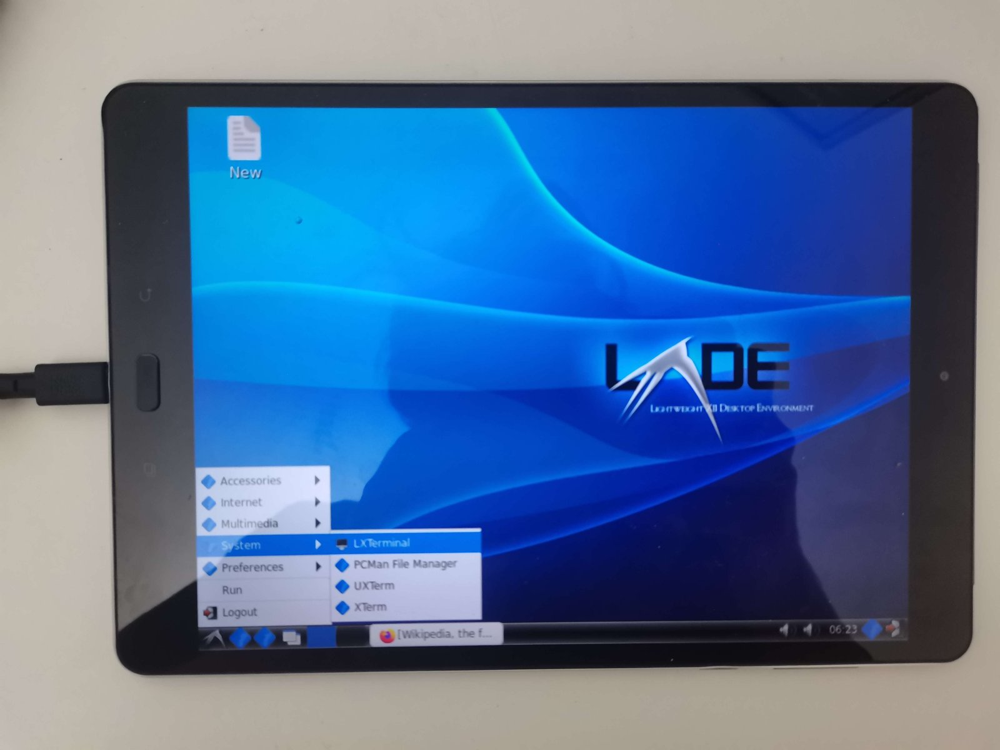
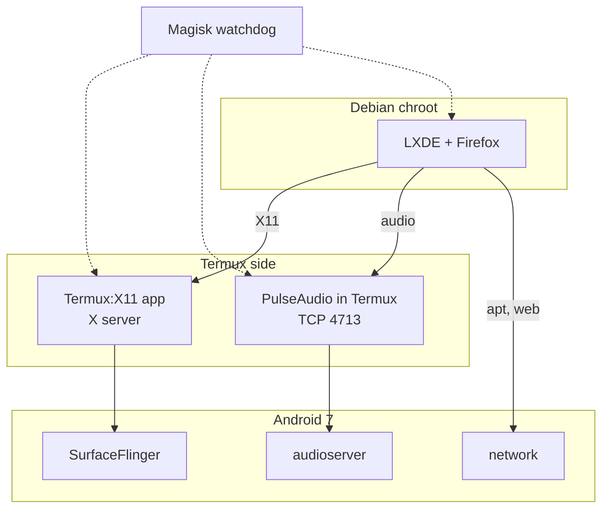

# Debian over Android on a ZenPad Z500M

An ASUS ZenPad 3S 10 (Z500M, Android 7) running a full Debian desktop on top of Android:
LXDE, Firefox, YouTube with sound.

Video (9 s): [YouTube playing with sound](docs/img/youtube.mp4).

Mainline Linux can't drive this tablet's panel, Wi-Fi or GPU. The vendor kernel can, but its drivers are built
for Android: the display isn't standard DRM/KMS, the GPU driver only exists for Android, and sound only works
through Android. So Android stays.

Debian runs in a chroot. Termux:X11 carries its display to Android, PulseAudio running in Termux carries its sound,
and a Magisk boot script starts everything and restarts whatever stops.

## Steps

1. [Unlock and root](docs/01-unlock-and-root.md)
2. [The Debian chroot](docs/02-debian-chroot.md)
3. [Display](docs/03-display.md)
4. [Audio](docs/04-audio.md)
5. [Boot and self-healing](docs/05-boot-and-self-healing.md)
6. [Performance and power](docs/06-performance-and-power.md)
7. [Why not native Debian](docs/07-why-not-native-debian.md)

## Repository layout

| Folder | Content |
|---|---|
| `android/` | runs on Android: Magisk watchdog and debloat module, chroot launcher, Termux scripts |
| `chroot/` | files inside Debian |
| `termux-x11-patch/` | Termux:X11 fixes for Android 7 |
| `ashmem-shm/` | MIT-SHM for X clients in the chroot (the kernel has no SysV shared memory) |
| `hardware/` | device trees (`.dts`) and hardware inventory |
| `evidence/` | raw benchmark outputs and the scripts that produced them |
| `docs/` | write-ups for each step, photos in `docs/img/` |
| `tools/` | privacy check, invisible cursor theme generator |

## License

MIT, except `termux-x11-patch/` (GPL-3.0) and `hardware/*.dts` (GPL-2.0). See [NOTICE.md](NOTICE.md).
