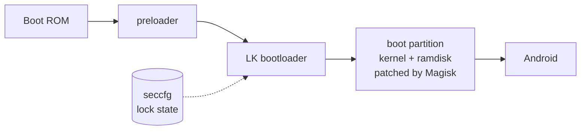

# Unlock and root

Everything else in this project needs root. Getting it took three steps: unlock the bootloader,
patch the boot image with Magisk, install it. A Magisk module then hides the preinstalled bloat
without touching `/system`.

Done on the stock firmware `WW_P027 14.0210.1806.33` (Android 7.0).



## Unlocking the bootloader

While locked, LK refuses a boot partition that isn't signed by ASUS. The lock state lives in the `seccfg`
partition, encrypted with a per-device key held in TrustZone.

LK doesn't check images sent with `fastboot boot`, which run once from RAM without writing anything.
That's enough to start TWRP and run the community unlock tool for the Z500M.

- TWRP: the unofficial 3.2.1 port for the Z500M by rakomancha and diplomatic, `twrp-3.2.1-0-z500m.zip`
  from their [XDA thread](https://xdaforums.com/t/twrp-recovery-asus-zenpad-3s-10-z500m.3758333/) (February 2018 update).
- Unlock tool: `unlock_tool_z500m_v0.6a.zip` by diplomatic
  ([XDA thread](https://xdaforums.com/t/tool-unlock-bootloader-in-asus-zenpad-3s-10-z500m-p027.3730909/)).
  It holds `unlockbl.sh` and `tool_bin_arc`, a tar archive the script unpacks itself.

```sh
adb reboot bootloader
fastboot boot twrp-3.2.1-0-z500m.img
```

In TWRP: cancel the decryption prompt and choose Keep Read Only. With dm-verity active, any write
to `/system` leaves the tablet unbootable. Then Mount > System, still read-only: the tool needs the vendor
crypto libraries in `/system/vendor/lib64`. With `/data` not decrypted, `/data/local/tmp` and `/sdcard`
only exist in RAM until the next reboot.

Keep your own copy of `seccfg` first, then run the tool:

```sh
adb shell dd if=/dev/block/platform/mtk-msdc.0/11230000.MSDC0/by-name/seccfg of=/tmp/seccfg-backup.bin
adb pull /tmp/seccfg-backup.bin
adb push unlockbl.sh tool_bin_arc /data/local/tmp/
adb shell
cd /data/local/tmp
sh unlockbl.sh        # 1 = unlock, then type: Yes, I want to unlock
```

The tool reads `seccfg`, has TrustZone decrypt it, flips the lock flag, re-encrypts it and writes it back.

After a reboot, LK shows the orange-state warning and boots unsigned images. In Android:

```sh
adb shell getprop ro.boot.verifiedbootstate    # orange
adb shell getprop ro.boot.flash.locked         # 0
```

`fastboot flash` stays disabled, even unlocked.

## Rooting with Magisk

Back up the stock boot partition first, from TWRP:

```sh
adb reboot bootloader
fastboot boot twrp-3.2.1-0-z500m.img
adb shell dd if=/dev/block/platform/mtk-msdc.0/11230000.MSDC0/by-name/boot of=/tmp/boot-stock.img
adb pull /tmp/boot-stock.img
```

Back in Android, patch it with the [Magisk app](https://github.com/topjohnwu/Magisk/releases) (31.1 still installs on Android 7):

```sh
adb install Magisk.apk
adb shell pm grant com.topjohnwu.magisk android.permission.READ_EXTERNAL_STORAGE
adb shell pm grant com.topjohnwu.magisk android.permission.WRITE_EXTERNAL_STORAGE
adb push boot-stock.img /sdcard/Download/
```

Magisk > Install > Select and Patch a File > `boot-stock.img`, then:

```sh
adb pull /sdcard/Download/magisk_patched-<id>.img magisk_patched.img
```

Test it from RAM before writing anything:

```sh
adb reboot bootloader
fastboot boot magisk_patched.img
adb shell su -c id        # tap Grant on the tablet -> uid=0(root)
```

Since `fastboot flash` is disabled, the permanent install happens from that rooted session:
Magisk > Install > Direct Install, then reboot. `adb shell su -c id` still answers `uid=0` after a normal boot.

## Debloating without touching /system

`pm disable-user` on some system packages, the WebView among them, sent the tablet into a boot loop.

A Magisk module hides the apps instead, and leaves the WebView alone. An empty `.replace` file in
`system/app/<App>/` or `system/priv-app/<App>/` makes Magisk mount an empty folder over the original at boot.
The [`zenpad-debloat`](../android/magisk/modules/zenpad-debloat/) module hides 38 apps this way, Google Play
services and the Play Store included. Each folder under its `system/` is one app: delete a folder to keep that app.
To install it, copy it into Magisk's module folder and reboot:

```sh
adb push android/magisk/modules/zenpad-debloat /data/local/tmp/
adb shell
su
cp -r /data/local/tmp/zenpad-debloat /data/adb/modules/
reboot
```

Magisk > Modules > Remove, then a reboot, brings them all back.

## Getting back

- Unroot, from TWRP:
  ```sh
  adb push boot-stock.img /tmp/
  adb shell dd if=/tmp/boot-stock.img of=/dev/block/platform/mtk-msdc.0/11230000.MSDC0/by-name/boot
  ```
- Re-lock: restore the stock boot image first, or the tablet won't boot. Then run the tool from TWRP again and choose 2. It flips the flag back, no backup needed.
- `fastboot boot` always works, so an image never has to be written to be tested.
- TWRP can't read the encrypted `/data`, so Android-side mistakes are fixed over adb, during the seconds Android stays up in a boot loop. That's how the `pm disable-user` loop was undone (`pm enable <package>`).

---

[All steps](../README.md#steps) · Next: [The Debian chroot](02-debian-chroot.md)
