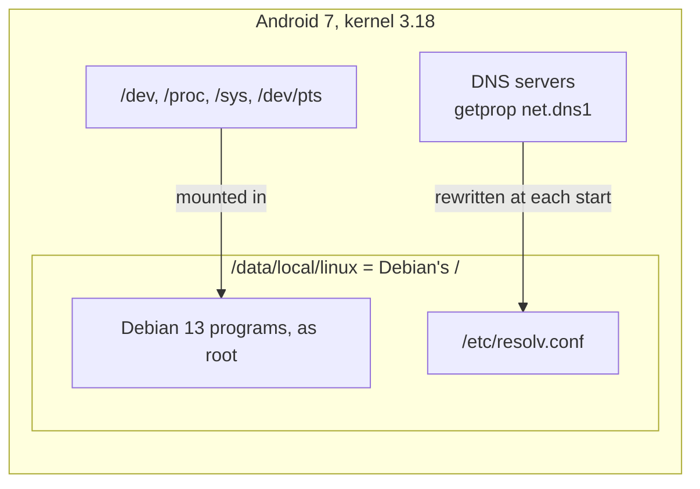
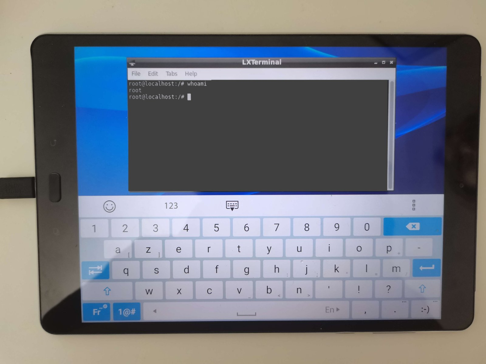

# The Debian chroot

Debian runs in a folder, `/data/local/linux`, on Android's own kernel (the ASUS 3.18 kernel).
`chroot` makes that folder the `/` of every Debian program. Same kernel, so the screen, Wi-Fi and
sound drivers keep working, and programs run at native speed.

Everything here runs as root, through Magisk's `su`.



## The root filesystem

Debian 13 (trixie) for arm64, from images.linuxcontainers.org, which publishes plain rootfs tarballs.
`<build>` is the newest dated folder:

```sh
curl -fLo rootfs.tar.xz https://images.linuxcontainers.org/images/debian/trixie/arm64/default/<build>/rootfs.tar.xz
adb push rootfs.tar.xz /data/local/tmp/debian-rootfs.tar.xz
adb shell
su
BB=/data/adb/magisk/busybox
mkdir -p /data/local/linux && cd /data/local/linux
$BB xz -dc /data/local/tmp/debian-rootfs.tar.xz | $BB tar -xpf -
```

It goes to `/data`, the big ext4 partition. `/sdcard` is sdcardfs, which can't store Unix owners and
permissions. Extracting as root keeps the owners, and `tar -p` keeps the exact permissions.
Magisk's busybox provides `xz`, `tar`, `mount` and `chroot`.

Files under [`chroot/`](../chroot/) in this repo go to the same path under `/data/local/linux`.

Measured with the desktop and Firefox installed: Debian 13.7, 550 packages, 2.9 GB (`du -shx`).

## Entering it

From the same root shell:

```sh
ROOT=/data/local/linux
rm -f $ROOT/etc/resolv.conf
{ echo "nameserver $(getprop net.dns1)"; echo "nameserver 8.8.8.8"; } > $ROOT/etc/resolv.conf
$BB mount --bind /dev $ROOT/dev
$BB mount -t proc proc $ROOT/proc
$BB mount -t sysfs sys $ROOT/sys
$BB mount -t devpts devpts $ROOT/dev/pts
$BB chroot $ROOT /usr/bin/env -i HOME=/root USER=root TERM=xterm \
  PATH=/usr/local/sbin:/usr/local/bin:/usr/sbin:/usr/bin:/sbin:/bin LANG=C.UTF-8 /bin/bash
```

- In the rootfs, `resolv.conf` is a link to a file systemd would create, and systemd doesn't run here.
  The link is replaced by a real file, filled from Android's DNS servers (system properties `net.dns1`,
  `net.dns2`), with 8.8.8.8 as a fallback.
- `/dev` is Android's own, bind-mounted. `/proc`, `/sys` and `/dev/pts` are fresh mounts.
- `env -i` drops Android's environment. Its `PATH` (`/sbin:/vendor/bin:/system/sbin:/system/bin:/system/xbin`)
  has no `/bin` or `/usr/bin`.

[`android/start-linux.sh`](../android/start-linux.sh) does the same. It lives in `/data/local/tmp` and runs
as root, from adb or from the boot script ([Boot and self-healing](05-boot-and-self-healing.md)).
It rewrites `resolv.conf` at every start, because the DNS servers change with the Wi-Fi network,
skips mounts that are already there, and ends by starting the desktop instead of a shell ([Display](03-display.md)).

Unmount everything before deleting `/data/local/linux`: with `/dev` bind-mounted, `rm -rf` would also
delete Android's device nodes.

`adb shell su -c '...'` reaches the tablet without its quotes, so pipes, redirects and `$(...)` run there
without root. For those, open a root shell (`adb shell`, then `su`), or push a script and run
`adb shell su -c 'sh /data/local/tmp/script.sh'`.

## Network: everything runs as root

Android's kernel only lets root, or members of the `inet` group (GID 3003), use the network
(`CONFIG_ANDROID_PARANOID_NETWORK`, on by default in the
[ASUS kernel source](https://github.com/Goayandi/android_kernel_asus_z500m)).
So every program in the chroot runs as root, apt included.



apt's settings are in [`chroot/etc/apt/apt.conf.d/99net`](../chroot/etc/apt/apt.conf.d/99net),
copied in before the first `apt-get update`:

```sh
adb push chroot/etc/apt/apt.conf.d/99net /data/local/tmp/
adb shell su -c 'cp /data/local/tmp/99net /data/local/linux/etc/apt/apt.conf.d/'
```

```
APT::Sandbox::User "root";
Acquire::ForceIPv4 "true";
Acquire::Retries "6";
Acquire::http::Timeout "30";
```

The first line makes apt run as root. The others force IPv4 and make downloads more patient.

## SELinux stays on

SELinux stays enforcing (`getenforce` answers `Enforcing`). The chroot runs in the SELinux context of
Magisk's `su`, which is allowed to do all of this. `setenforce 0` was never needed.

---

Previous: [Unlock and root](01-unlock-and-root.md) · [All steps](../README.md#steps) · Next: [Display](03-display.md)
