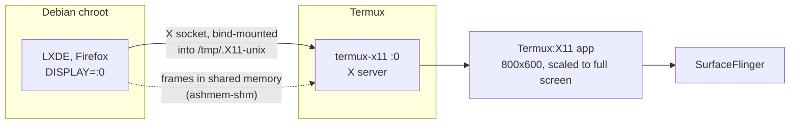
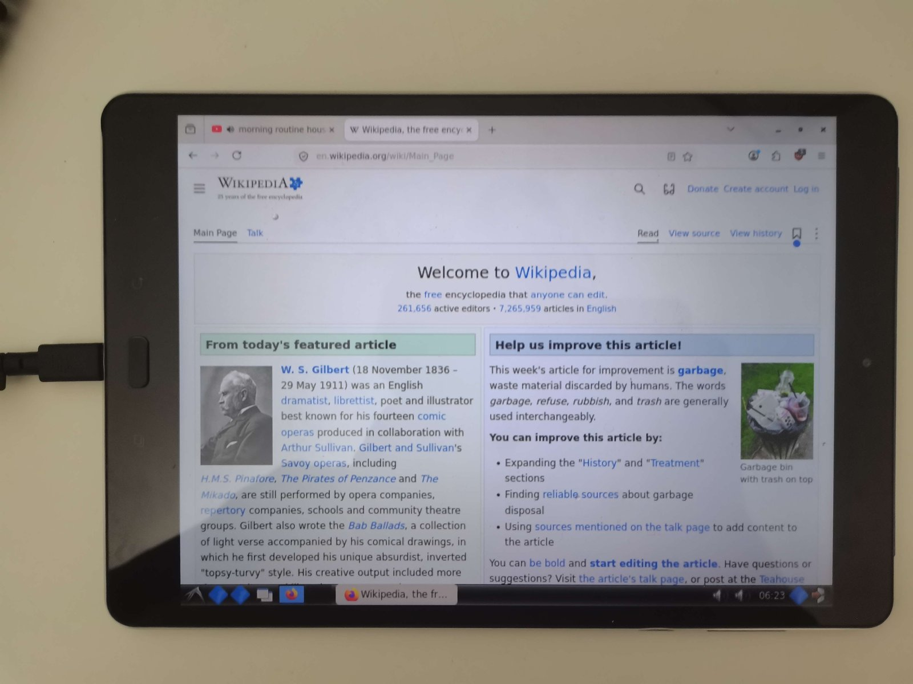

# Display

Debian's programs draw to an X server that runs in Termux, and the Termux:X11 app shows its screen
full screen like any other Android app. Android composites it with SurfaceFlinger, as usual.



## Termux:X11 on Android 7

Termux:X11 comes in two parts: the `termux-x11-nightly` package in Termux, which runs the X server, and the
Termux:X11 app, which shows it. The upstream app doesn't connect on Android 7, so the app is a patched
rebuild. The package stays stock, except for its signature check, and is held at its version.
All of this is in [`termux-x11-patch/`](../termux-x11-patch/README.md).

In Termux (from F-Droid):

```sh
pkg install x11-repo
pkg install termux-x11-nightly
```

On the PC, after building the app as described in `termux-x11-patch/`:

```sh
adb install termux-x11-android7.apk
```

[`android/termux/bin/zenpad-x11.sh`](../android/termux/bin/zenpad-x11.sh) starts the server, as the Termux app.
Termux:Boot or the boot script run it ([Boot and self-healing](05-boot-and-self-healing.md)). The part that matters:

```sh
export TMPDIR=$HOME/.x11tmp
OLD_CONTEXT=1 termux-x11 :0 -ac
```

The socket lives in `$HOME/.x11tmp` because Termux wipes `$PREFIX/tmp` when it restarts.
`OLD_CONTEXT=1`, an upstream switch, avoids a code path that only works on Android 8 and later.
`-ac` turns off X access control (the socket is local).

## Sharing the socket with the chroot

X programs look for `/tmp/.X11-unix/X0`. The boot script bind-mounts Termux's socket folder there, as root:

```sh
mount --bind /data/data/com.termux/files/home/.x11tmp/.X11-unix /data/local/linux/tmp/.X11-unix
```

If that mount goes stale, it shows as `(deleted)` in `/proc/mounts`, and the boot script redoes it.
A restart of the X server alone keeps the folder, so the mount stays valid.

## The desktop

LXDE is the desktop: a window manager, a taskbar and desktop icons. In the chroot:

```sh
apt-get install -y --no-install-recommends lxde-core lxterminal dbus-x11 fonts-dejavu-core x11-xserver-utils firefox-esr
```

[`chroot/root/start-desktop-x11.sh`](../chroot/root/start-desktop-x11.sh) starts it on the X server
(`DISPLAY=:0`). LXDE's session manager doesn't start the taskbar (`lxpanel`) or the desktop icons
(`pcmanfm --desktop`) here, so the script starts them itself. Without them, the screen stays gray.
[`start-linux.sh`](../android/start-linux.sh) runs that script in the chroot, then brings the Termux:X11 app
to the front.

The boot script does all of this. By hand, the order is: the X server in Termux, the bind mount,
then `sh /data/local/tmp/start-linux.sh` as root.



## Four fixes

1. Apps hang without `LIBGL_DRI3_DISABLE=1`. Termux:X11 offers DRI3, a way for programs to hand frames
   to the X server directly, but from inside the chroot Mesa waits on it forever, and GTK apps (most of the desktop) freeze.
   `start-desktop-x11.sh` sets the variable.
2. Frames go through shared memory. This kernel has no System V shared memory (`/proc/sysvipc` doesn't
   exist), so X programs sent every frame through the socket. [`ashmem-shm/`](../ashmem-shm/README.md) gives
   them shared memory that Termux:X11 understands; its README shows how to build and load it. Measured with glxgears
   in a 1000×700 window (software rendering): 37 to 62 FPS, and the X server from 20% to 12% of a core.
3. 800×600, scaled up. In the Termux:X11 preferences: display resolution mode `custom`, resolution `800x600`,
   filtering `bilinear`. The app scales it to the 2048×1536 panel: same 4:3 shape, 6.5 times fewer pixels
   for the CPU to draw.
4. One mouse pointer. Android draws its own arrow and ignores requests to hide it, so X uses an invisible
   cursor theme. Make it in the chroot with [`tools/mkinvis-cursor-theme.py`](../tools/mkinvis-cursor-theme.py):
   `python3 mkinvis-cursor-theme.py /usr/share/icons/invisible`. `start-desktop-x11.sh` sets
   `XCURSOR_THEME=invisible`.

Everything is drawn by the CPU (Mesa's llvmpipe). A GPU path was tried and was slower:
see [Performance and power](06-performance-and-power.md).

---

Previous: [The Debian chroot](02-debian-chroot.md) · [All steps](../README.md#steps) · Next: [Audio](04-audio.md)
