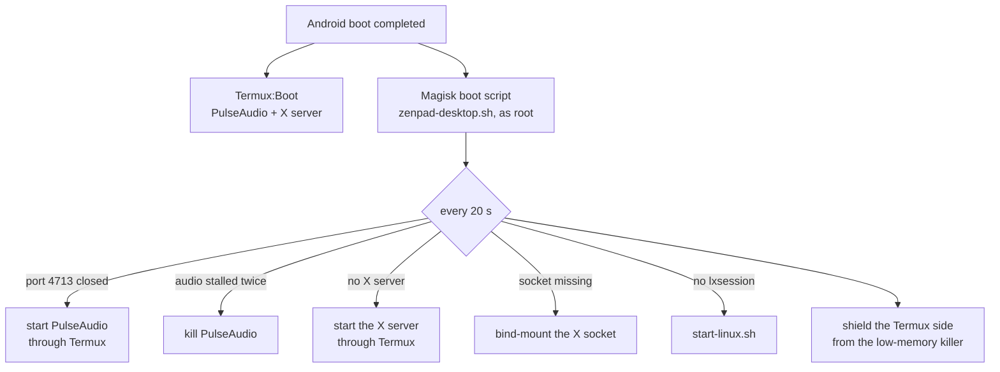

# Boot and self-healing

At boot, Termux:Boot and a Magisk script start the X server, PulseAudio and the desktop. The Magisk script
then checks them every 20 seconds and restarts whatever stopped.



## Two starters

- Termux:Boot, a Termux add-on from F-Droid, runs [`~/.termux/boot/start-pa.sh`](../android/termux/boot/start-pa.sh)
  after boot: PulseAudio and the X server. It has to be opened once by hand, and Termux must be exempt from
  battery optimization. Even then, on this ROM, it doesn't always fire.
- [`android/magisk/service.d/zenpad-desktop.sh`](../android/magisk/service.d/zenpad-desktop.sh) runs as root
  at every boot. It waits for `sys.boot_completed`, gives Termux:Boot up to 45 s to start the X server, then loops.

Measured on one boot: the desktop was up 20 s after Android finished booting.

## Installing

The root side, from the PC:

```sh
adb push android/magisk/service.d/zenpad-desktop.sh android/start-linux.sh chroot/root/start-desktop-x11.sh /data/local/tmp/
adb shell su -c 'cp /data/local/tmp/zenpad-desktop.sh /data/adb/service.d/'
adb shell su -c 'chmod 755 /data/adb/service.d/zenpad-desktop.sh'
```

Magisk skips a `service.d` script that isn't executable.

The Termux side has to stay owned by Termux, so it's copied from Termux itself. On the PC:

```sh
adb push android/termux/bin/zenpad-x11.sh android/termux/bin/zenpad-audio.sh \
  android/termux/boot/start-pa.sh android/termux/termux.properties /sdcard/Download/
```

Then in Termux (after `termux-setup-storage`):

```sh
mkdir -p ~/bin ~/.termux/boot
cp ~/storage/downloads/zenpad-x11.sh ~/storage/downloads/zenpad-audio.sh ~/bin/
cp ~/storage/downloads/start-pa.sh ~/.termux/boot/
cp ~/storage/downloads/termux.properties ~/.termux/
termux-reload-settings
```

## Starting Termux programs from root

PulseAudio and the X server belong to Termux and run as the Termux app ([Audio](04-audio.md)).
The script asks Termux to run them, through Termux's `RUN_COMMAND` service. For PulseAudio:

```sh
am startservice --user 0 -n com.termux/com.termux.app.RunCommandService -a com.termux.RUN_COMMAND \
  --es com.termux.RUN_COMMAND_PATH /data/data/com.termux/files/usr/bin/sh \
  --esa com.termux.RUN_COMMAND_ARGUMENTS /data/data/com.termux/files/home/bin/zenpad-audio.sh \
  --ez com.termux.RUN_COMMAND_BACKGROUND true
```

The same call with `zenpad-x11.sh` starts the X server. It needs `allow-external-apps = true` in
[`~/.termux/termux.properties`](../android/termux/termux.properties).

## The loop

Every 20 s:

1. Auto-start is allowed again for Termux, Termux:Boot and Termux:X11 (`appops set <package> AUTO_RUN allow`,
   an app-op of this ASUS firmware). ASUS Mobile Manager can block it again.
2. PulseAudio: if nothing listens on port 4713 (`/proc/net/tcp`), it's started.
3. Every third round, about once a minute, the audio output is tested: 0.3 s of silence through `pacat` in
   the chroot. A healthy output takes about 0.4 s. The test fails if it hasn't finished after 10 s.
   After two failures in a row, PulseAudio is killed, and the next round starts it again.
4. X server: if `termux-x11 :0` isn't running, the desktop's leftovers are stopped and the server is started.
5. The X socket folder is bind-mounted into the chroot, again if the old mount shows as deleted.
6. Desktop: if `lxsession` isn't running, [`start-linux.sh`](../android/start-linux.sh) runs. It brings the
   Termux:X11 app to the front.
7. The X server, PulseAudio, Termux and Termux:X11 get `oom_score_adj` -800, so Android's low-memory killer
   leaves them alone. Android can reset that value, so it's set again every round.

To pause it: `touch /data/local/tmp/zenpad-watchdog.off`. It logs to `/data/local/tmp/zenpad-watchdog.log`
(a sample is in [`evidence/raw/`](../evidence/raw/zenpad-watchdog.log)).

## Restart it the Magisk way

Magisk runs boot scripts with BusyBox `ash` in "standalone" mode, where `cat`, `tr` and the like are built in.
Restarted with Android's `/system/bin/sh`, the script used 20% of a core instead of 2%:
plain `sh` runs a separate program for each of those commands, thousands of times a minute here
([`evidence/how-measured/wdcost.sh`](../evidence/how-measured/wdcost.sh)). To restart it by hand, from `adb shell`:

```sh
su -mm
kill $(cat /data/local/tmp/zenpad-watchdog.pid)
nohup env ASH_STANDALONE=1 /data/adb/magisk/busybox sh -o standalone /data/adb/service.d/zenpad-desktop.sh >/dev/null 2>&1 &
```

`-mm` runs the root shell in the global mount namespace, so its mounts are visible to everything else, like at boot.
The script writes its PID to that file and exits at once if another copy is running.

---

Previous: [Audio](04-audio.md) · [All steps](../README.md#steps) · Next: [Performance and power](06-performance-and-power.md)
